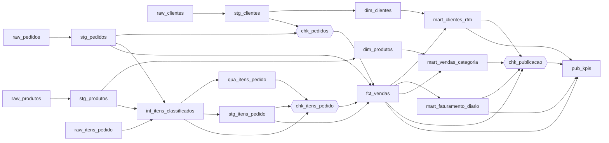

# N1-1: Orquestrando Transformações SQL com um DAG

Pipeline de dados para um **painel diário de vendas**: os dados saem dos arquivos de origem, passam por limpeza, validação e modelagem e terminam como indicadores publicados. Cada etapa é uma transformação SQL. As etapas são os **nós** de um grafo direcionado acíclico (DAG), e as dependências entre elas são as **arestas**. Um orquestrador em Python lê o grafo, garante que ele não tem ciclos, calcula a ordem de execução e roda cada etapa no SQLite.

> O grafo aqui **não** representa relações entre clientes e produtos (grafo de dados). Ele representa **tarefas e a ordem em que precisam ser executadas** (DAG de execução).

## Como executar

Só precisa de Python 3.10 ou mais recente. Não há dependências externas: o SQLite já vem com o Python.

```bash
py dag.py                      # executa o pipeline completo e gera saida/dag.html
py dag.py --validar            # só valida o grafo e mostra a ordem de execução
py dag.py --a-partir-de fct_vendas   # reexecuta uma etapa e tudo o que depende dela
py dag.py --dados dados/raw_falha --banco saida/analytics_falha.db --html saida/dag_falha.html
                               # cenário com origem quebrada: mostra o bloqueio da publicação
py dag.py --mermaid            # imprime o grafo em sintaxe Mermaid
py -m unittest discover -s tests     # testes automatizados
py gerar_dados.py [--cenario falha]  # regenera os CSVs de origem (determinístico)
```

(No Linux ou macOS, troque `py` por `python3`.)

## Estrutura

```
dag.py             orquestrador: lê as tarefas, valida o DAG, ordena e executa
visualizacao.py    gera a visualização HTML do grafo de execução (atividade extra)
gerar_dados.py     gera os CSVs de origem sintéticos
pipeline/*.sql     uma tarefa por arquivo (nó do grafo)
dados/raw/         origem "normal" (com sujeira típica que o pipeline trata)
dados/raw_falha/   origem quebrada, para demonstrar o tratamento de falhas
tests/             testes do orquestrador e do pipeline
saida/             banco SQLite e HTML gerados (não versionar)
```

### Como uma tarefa declara o próprio nó e as arestas

Cada arquivo `.sql` traz um cabeçalho com metadados. O nome do arquivo é o nome da tarefa e também o nome da tabela que ela produz:

```sql
-- @tipo: sql                       -- extract | sql | check
-- @camada: core
-- @depende_de: stg_itens_pedido, stg_pedidos, chk_pedidos, chk_itens_pedido
-- @descricao: Fato de vendas no grão de item...
DROP TABLE IF EXISTS fct_vendas;
CREATE TABLE fct_vendas AS
SELECT ...
```

Os três tipos de tarefa:

| Tipo | O que o orquestrador faz |
|---|---|
| `extract` | Executa o DDL da tabela `raw_*` e carrega o CSV declarado em `@fonte`. As colunas sem `_` formam o **contrato** com a origem: se o CSV não tiver alguma delas, a etapa falha. |
| `sql` | Executa o script dentro de uma **transação**. Ou a tabela nova fica pronta, ou a versão anterior permanece intacta. |
| `check` | Executa um `SELECT` que lista violações (`regra`, `detalhe`). Zero linhas = aprovado. Qualquer linha = falha, e tudo a jusante é bloqueado. |

## O DAG



São 20 tarefas e 32 dependências, organizadas em 9 ondas. Tarefas da mesma onda não dependem umas das outras e poderiam rodar em paralelo:

| Onda | Tarefas |
|---|---|
| 0 | `raw_clientes`, `raw_itens_pedido`, `raw_pedidos`, `raw_produtos` |
| 1 | `stg_clientes`, `stg_pedidos`, `stg_produtos` |
| 2 | `dim_clientes`, `chk_pedidos`, `dim_produtos`, `int_itens_classificados` |
| 3 | `qua_itens_pedido`, `stg_itens_pedido` |
| 4 | `chk_itens_pedido` |
| 5 | `fct_vendas` |
| 6 | `mart_clientes_rfm`, `mart_faturamento_diario`, `mart_vendas_categoria` |
| 7 | `chk_publicacao` |
| 8 | `pub_kpis` |

## Responsabilidade de cada etapa e fluxo dos dados

Os dados fluem por seis camadas: **raw → staging → qualidade → core → mart → publicação**.

### 1. Raw: ingestão sem transformação
| Etapa | Responsabilidade |
|---|---|
| `raw_clientes`, `raw_produtos`, `raw_pedidos`, `raw_itens_pedido` | Copiam cada CSV de origem para uma tabela com todas as colunas em `TEXT`, sem limpar nada. Guardam `_arquivo` e `_carregado_em` para **linhagem**: dá para saber de onde e quando cada linha veio. Validam o contrato de colunas e têm 2 tentativas, porque leitura de arquivo pode falhar de forma transitória. |

### 2. Staging: tipagem, padronização e deduplicação
| Etapa | Responsabilidade |
|---|---|
| `stg_clientes` | Converte os tipos, aplica `TRIM`, deixa o e-mail em minúsculas e a UF em maiúsculas. Clientes reenviados pela origem são deduplicados com `ROW_NUMBER()`, e fica o cadastro mais recente. |
| `stg_produtos` | Converte o preço para `REAL`, padroniza a categoria e mantém um registro por produto. |
| `stg_pedidos` | Converte os tipos (data inválida vira `NULL`, para o check pegar), normaliza o status (`' ENTREGUE'` → `entregue`) e remove os pedidos duplicados pela extração. |
| `int_itens_classificados` | Converte os tipos de todos os itens e classifica cada um em `motivo_rejeicao`: quantidade não positiva, preço negativo, desconto fora do intervalo, pedido inexistente ou produto inexistente. |
| `stg_itens_pedido` | Itens aprovados (`motivo_rejeicao IS NULL`). |
| `qua_itens_pedido` | **Quarentena**: itens rejeitados, guardados com o motivo para investigação, em vez de sumirem em silêncio. |

### 3. Qualidade: portões que bloqueiam o fluxo
| Etapa | Responsabilidade |
|---|---|
| `chk_pedidos` | Contrato dos pedidos: data válida, status dentro do domínio (`pago`, `entregue`, `cancelado`) e cliente existente (integridade referencial). |
| `chk_itens_pedido` | Aceita até **5%** dos itens em quarentena. Acima disso, o problema está na origem e o fato não deve ser gerado. Também garante `id_item` único. |
| `chk_publicacao` | **Reconciliação** antes de publicar: a receita somada em cada mart precisa bater com a do fato, sem mart vazio nem receita negativa. |

### 4. Core: modelo dimensional
| Etapa | Responsabilidade |
|---|---|
| `dim_clientes` | Dimensão de clientes. **Não leva o e-mail** (dado pessoal): quem consome indicadores não precisa dele, pelo princípio do menor privilégio. |
| `dim_produtos` | Dimensão de produtos, com categoria e preço de tabela. |
| `fct_vendas` | Fato no grão de item, só de pedidos pagos ou entregues, com receita bruta e líquida. Depende dos dois checks, então só roda se eles passarem. |

### 5. Mart: tabelas para o consumo analítico
| Etapa | Responsabilidade |
|---|---|
| `mart_faturamento_diario` | Pedidos, unidades, receita e ticket médio por dia. |
| `mart_vendas_categoria` | Receita por categoria e participação no total. |
| `mart_clientes_rfm` | Segmentação RFM (recência, frequência, valor) de cada cliente: fiel, ativo, em risco ou inativo. |

### 6. Publicação
| Etapa | Responsabilidade |
|---|---|
| `pub_kpis` | Indicadores finais do painel (receita, pedidos, ticket médio, clientes compradores, melhor dia). É a última etapa e só acontece depois da reconciliação. |

## Como o orquestrador coordena as transformações

1. **Leitura do grafo.** Cada `.sql` vira um nó, e cada item de `@depende_de` vira uma aresta `dependência → tarefa`.
2. **Validação estrutural** (antes de executar qualquer coisa):
   - toda dependência declarada precisa existir;
   - **linhagem coerente**: se o SQL de uma tarefa lê uma tabela produzida por outra tarefa, essa tabela precisa estar em `@depende_de`. Isso impede que uma etapa rode antes da tabela que ela lê. O contrário é permitido: depender de um `check` sem ler nada dele é uma dependência de controle, um portão;
   - **ausência de ciclos**: ordenação topológica pelo algoritmo de Kahn. Se sobrar nó sem ser ordenado, existe ciclo, e o orquestrador mostra qual é (ex.: `a -> c -> b -> a`).
3. **Ordem de execução.** As tarefas rodam na ordem topológica, então nenhuma etapa começa antes de todas as suas dependências terminarem.
4. **Falhas.** Se uma etapa falha, tudo o que depende dela, direta ou indiretamente, fica **bloqueado**. Ramos independentes continuam (no cenário de falha, `dim_clientes` e `dim_produtos` ainda são construídas). Erros de SQL são desfeitos com `ROLLBACK`, então a versão anterior da tabela continua válida.
5. **Reexecução idempotente.** Toda etapa faz `DROP TABLE IF EXISTS` + `CREATE TABLE ... AS` dentro de uma transação. Rodar de novo produz o mesmo resultado, sem duplicar linhas. `--a-partir-de` reexecuta só uma etapa e seus descendentes, por exemplo depois de corrigir uma regra.
6. **Observabilidade.** Cada execução fica registrada em `meta_execucoes` (tarefa, status, tentativas, início, fim, duração, linhas, mensagem), e as violações de qualidade ficam em `meta_violacoes`. Ao final, o orquestrador gera `saida/dag.html`.

## Demonstração de falha

`dados/raw_falha` traz pedidos de clientes que não existem, uma data impossível (`2026-13-40`) e 1 em cada 8 itens com quantidade negativa:

```
  [FALHOU]    chk_pedidos         6 violação(ões): data_pedido inválida | pedido 11; cliente inexistente | ...
  [ok]        dim_produtos        ...  <- ramo independente continua
  [FALHOU]    chk_itens_pedido    1 violação(ões): taxa de quarentena acima de 5% | 13.1% dos itens (97 de 740)
  [bloqueada] fct_vendas          aguardava chk_pedidos, chk_itens_pedido
  ...
  [bloqueada] pub_kpis            aguardava chk_publicacao, ...
```

Nenhum número inválido é publicado, e as violações ficam registradas para investigação:

```sql
SELECT * FROM meta_violacoes WHERE id_execucao = '<id mostrado no terminal>';
SELECT motivo_rejeicao, COUNT(*) FROM qua_itens_pedido GROUP BY 1;
```

## Visualização do grafo de execução (extra)

`saida/dag.html` é uma página autocontida, que abre direto no navegador e não precisa de internet:

- colunas = ondas do DAG; cor da faixa = camada; preenchimento = resultado (ok, falhou, bloqueada);
- arestas tracejadas em vermelho saem de etapas que falharam ou foram bloqueadas;
- clicar num nó mostra a responsabilidade da etapa, as dependências, o impacto a jusante, as métricas da execução e o SQL, e destaca tudo o que vem antes e depois dela;
- abaixo do grafo fica a tabela com a ordem topológica de execução.

## Consultas úteis

```sql
-- histórico de execuções
SELECT id_execucao, tarefa, status, duracao_ms, linhas, mensagem
FROM meta_execucoes ORDER BY inicio DESC;

-- indicadores publicados
SELECT * FROM pub_kpis;
SELECT * FROM mart_vendas_categoria;
SELECT segmento, COUNT(*), ROUND(SUM(valor), 2) FROM mart_clientes_rfm GROUP BY 1;
```

## Limitações e próximos passos

- As ondas mostram o que **poderia** rodar em paralelo, mas a execução é sequencial: o SQLite aceita um único escritor por vez. Num banco como PostgreSQL ou DuckDB, cada onda poderia ir para um pool de workers.
- Os dados são sintéticos e gerados de forma determinística (`gerar_dados.py`, semente fixa).
- Num ambiente real, a extração leria de um banco ou de uma API, com as credenciais em variáveis de ambiente ou num cofre de segredos, nunca no código. A mesma estrutura de tarefas também poderia ser migrada para Airflow ou dbt.
